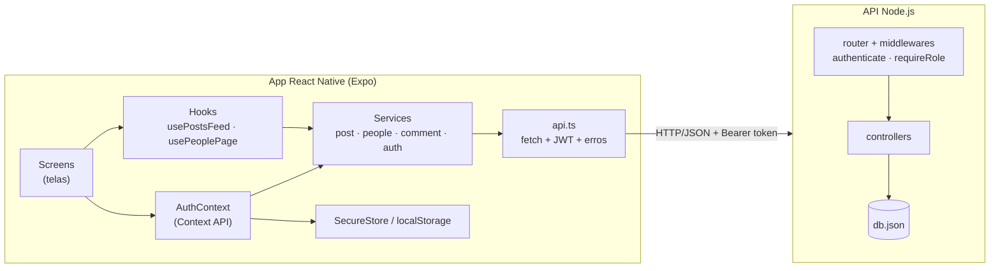
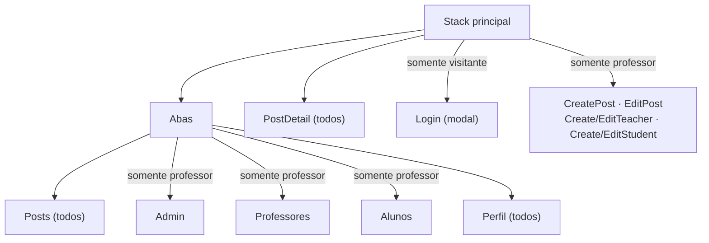
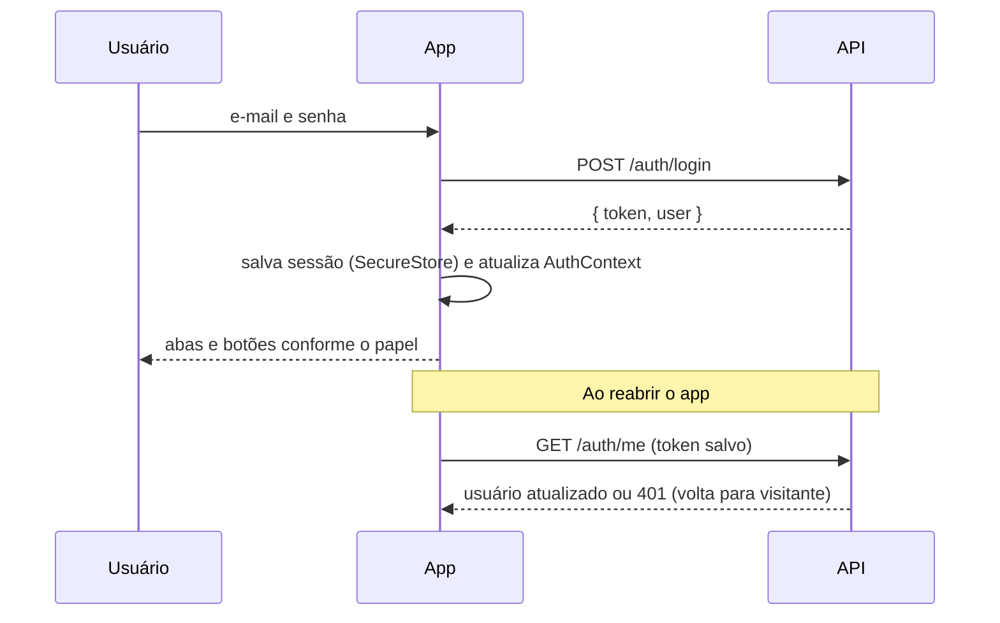

# Blog Escolar — Mobile (Tech Challenge · Fase 4)

Aplicativo mobile em **React Native (Expo + TypeScript)** para a plataforma de blogging da escola, com uma **API REST em Node.js** para posts, professores, alunos, comentários e autenticação.

Professores publicam, editam e administram conteúdos e gerenciam professores e alunos. Alunos leem e comentam. Visitantes podem ler os posts.

---

## Sumário

- [Requisitos atendidos](#requisitos-atendidos)
- [Tecnologias](#tecnologias)
- [Estrutura do repositório](#estrutura-do-repositório)
- [Setup inicial](#setup-inicial)
- [Arquitetura da aplicação](#arquitetura-da-aplicação)
- [Endpoints REST](#endpoints-rest)
- [Guia de uso](#guia-de-uso)
- [Testes e qualidade](#testes-e-qualidade)
- [Problemas comuns](#problemas-comuns)
- [Documentação complementar](#documentação-complementar)
- [Integrantes](#integrantes)

---

## Requisitos atendidos

### Requisitos funcionais

| # | Requisito | Onde está no app |
|---|-----------|------------------|
| 1 | Página principal: lista de posts (título, autor, breve descrição) + busca por palavra-chave | `mobile/src/screens/posts/PostListScreen.tsx` |
| 2 | Leitura do post completo + comentários (opcional, implementado) | `mobile/src/screens/posts/PostDetailScreen.tsx` |
| 3 | Criação de postagens (título, conteúdo, autor, botão enviar) | `mobile/src/screens/posts/CreatePostScreen.tsx` + `PostForm.tsx` |
| 4 | Edição de postagens (carrega dados atuais, botão salvar) | `mobile/src/screens/posts/EditPostScreen.tsx` |
| 5 | Criação de professores | `mobile/src/screens/people/index.tsx` → `CreateTeacherScreen` |
| 6 | Edição de professores | `mobile/src/screens/people/index.tsx` → `EditTeacherScreen` |
| 7 | Listagem paginada de professores com botões Editar e Excluir | `mobile/src/screens/people/index.tsx` → `TeacherListScreen` |
| 8 | Requisitos 5, 6 e 7 replicados para alunos | `CreateStudentScreen`, `EditStudentScreen`, `StudentListScreen` |
| 9 | Página administrativa: todas as postagens com editar e excluir | `mobile/src/screens/admin/AdminPostsScreen.tsx` |
| 10 | Login e autorização (só autenticados criam/editam/administram) | `LoginScreen.tsx`, `AuthContext.tsx`, `AppNavigator.tsx` + JWT na API |

### Requisitos técnicos

| Requisito | Como foi atendido |
|-----------|-------------------|
| React Native com hooks e componentes funcionais | 100% componentes funcionais; hooks nativos (`useState`, `useEffect`, `useCallback`, `useMemo`, `useRef`, `useContext`) e hooks próprios (`usePostsFeed`, `usePeoplePage`, `useDebounce`, `useAuth`) |
| Estilização com layout definido pelo grupo | Design tokens em `mobile/src/theme` (cores, espaçamentos, bordas, tipografia, sombras) e componentes reutilizáveis em `mobile/src/components` |
| Integração com back-end (posts, alunos, professores, autenticação) | Camada `mobile/src/services` com cliente HTTP próprio (`fetch` + token JWT + tratamento de erros) |
| Permissões professor × aluno | Rotas condicionais no app (aluno/visitante nem chegam às telas de escrita) + validação de papel na API (`401`/`403`) |
| Gerenciamento de estado | Context API (`AuthContext`) para sessão e permissões |
| Documentação no README | Este arquivo + pasta [`docs/`](docs) |

---

## Tecnologias

**Mobile** (`mobile/`)
- React Native 0.88 + **Expo SDK 58** + TypeScript
- React Navigation 7 (native stack + bottom tabs)
- Context API para autenticação
- `expo-secure-store` para guardar o token (Keychain/Keystore), com `localStorage` no Expo Web
- `@expo/vector-icons` (Ionicons)

**API** (`backend/`)
- Node.js 22, **sem dependências externas** (módulos nativos `http` e `crypto`)
- Autenticação JWT (HS256) e senhas com `scrypt` + salt
- Persistência em arquivo JSON (`backend/data/db.json`), criado com dados de exemplo na primeira execução
- Testes automatizados com `node:test` (24 testes)

> **Por que a API está junto?** O app consome endpoints de posts, professores, alunos e autenticação. A API deste repositório implementa todos eles, e o app roda de ponta a ponta sem configuração extra. Se o grupo preferir usar o back-end da fase anterior, basta apontar a variável `EXPO_PUBLIC_API_URL` para ele e ajustar as rotas em `mobile/src/services`.

---

## Estrutura do repositório

```
.
├── backend/                     # API REST (Node.js)
│   ├── src/
│   │   ├── controllers/         # Regras de cada recurso (auth, posts, pessoas, comentários)
│   │   ├── db/                  # Banco em JSON + dados de exemplo (seed)
│   │   ├── middlewares/         # authenticate (JWT) e requireRole (permissões)
│   │   ├── utils/               # http, jwt, senha, validação
│   │   ├── app.js               # Handler HTTP (CORS, parse do corpo, erros)
│   │   ├── router.js            # Roteador com parâmetros e middlewares
│   │   ├── routes.js            # Definição de todas as rotas
│   │   └── server.js            # Inicialização (mostra o IP para usar no celular)
│   └── tests/api.test.js
├── mobile/                      # App React Native (Expo)
│   ├── App.tsx                  # Providers + navegação
│   └── src/
│       ├── components/          # UI reutilizável (botões, campos, cards, paginação...)
│       ├── config/env.ts        # Descoberta automática da URL da API
│       ├── contexts/            # AuthContext (Context API)
│       ├── hooks/               # usePostsFeed, usePeoplePage, useDebounce
│       ├── navigation/          # Stack + Tabs com rotas protegidas
│       ├── screens/             # Telas (auth, posts, admin, people, profile)
│       ├── services/            # Cliente HTTP e serviços por recurso
│       ├── theme/               # Design tokens
│       ├── types/               # Tipos de domínio
│       └── utils/               # Formatação, validação e diálogos
├── docs/
│   ├── DOCUMENTACAO.md          # Arquitetura, uso e relato de experiências/desafios
│   ├── GITHUB.md                # Passo a passo para publicar no GitHub
│   └── ROTEIRO_VIDEO.md         # Roteiro da apresentação (até 15 min)
└── .github/workflows/ci.yml     # CI: roda os testes da API a cada push
```

---

## Setup inicial

### Pré-requisitos

- **Node.js 22.13 ou superior** (`node -v`)
- **Expo Go** instalado no celular (Android ou iOS), na versão compatível com a **SDK 58**. Também funciona em emulador Android, simulador iOS ou no navegador.
- Computador e celular **na mesma rede Wi-Fi**

### 1. Subir a API

```bash
cd backend
npm start
```

A API não tem dependências, então não precisa de `npm install`. Ela sobe na porta **3000** e mostra no terminal os endereços de acesso:

```
Blog Escolar API rodando na porta 3000
  Local:            http://localhost:3000
  Rede (celular):   http://192.168.0.10:3000
```

Na primeira execução é criado o arquivo `backend/data/db.json` com 7 professores, 12 alunos, 8 posts e alguns comentários. Para voltar aos dados iniciais: `npm run seed`.

### 2. Rodar o app

Em outro terminal:

```bash
cd mobile
npm install
npx expo install --fix   # alinha as versões dos pacotes com a SDK do Expo
npm start
```

Depois, leia o QR Code com o **Expo Go** (Android) ou com a câmera (iOS). Atalhos no terminal do Expo:

| Tecla | Abre em |
|-------|---------|
| `a` | Emulador Android |
| `i` | Simulador iOS (macOS) |
| `w` | Navegador (Expo Web) |

### 3. URL da API (automática)

O app descobre sozinho o endereço da API: usa o IP do computador que está rodando o Expo (o mesmo da API) na porta 3000. No emulador Android, usa `10.0.2.2`, e no navegador, `localhost`. A URL em uso aparece no rodapé da tela **Perfil**.

Para definir manualmente (por exemplo, com `--tunnel` ou com a API em outro computador), crie `mobile/.env`:

```bash
EXPO_PUBLIC_API_URL=http://192.168.0.10:3000
```

e reinicie com `npx expo start -c`.

### Contas de demonstração

Senha de todas as contas: **123456**

| Perfil | E-mail |
|--------|--------|
| Professor(a) | `professor@escola.com` |
| Aluno(a) | `aluno@escola.com` |

A tela de login tem atalhos que entram direto com essas contas.

---

## Arquitetura da aplicação

### Visão geral



### Camadas do app

| Camada | Responsabilidade |
|--------|------------------|
| `screens/` | Montam a interface e reagem às ações do usuário. Não fazem `fetch` direto. |
| `components/` | Peças visuais reutilizáveis: `AppButton`, `TextField`, `SearchBar`, `PostCard`, `PersonRow`, `Pagination`, `EmptyState`/`ErrorState`/`LoadingView`, `FormCard`. |
| `hooks/` | Lógica de listagem: `usePostsFeed` (busca + puxar para atualizar + rolagem infinita, descartando respostas antigas) e `usePeoplePage` (paginação numerada). |
| `contexts/AuthContext` | Estado global da sessão: login, logout, restauração da sessão ao abrir o app e flags `isTeacher`/`isStudent`. |
| `services/` | Um serviço por recurso da API. `api.ts` centraliza a URL base, o header `Authorization`, o timeout e a conversão de erros (`ApiError` com mensagens por campo). |
| `navigation/` | Stack principal + abas. As rotas protegidas só são registradas para quem tem permissão. |
| `theme/` | Design tokens (paleta, espaçamentos, raios, tipografia e sombras). |

### Navegação e proteção de rotas



As telas de criação, edição e administração **só existem na navegação** quando o usuário logado é professor (padrão de autenticação recomendado pelo React Navigation). Um aluno ou visitante não consegue nem navegar até elas. A API também valida o token e o papel em cada requisição: sem login retorna `401`, sem permissão retorna `403`.

### Fluxo de autenticação



---

## Endpoints REST

Base: `http://<ip-da-maquina>:3000`

| Método | Rota | Acesso | Descrição |
|--------|------|--------|-----------|
| POST | `/auth/login` | público | Login (professor ou aluno) → `{ token, user }` |
| GET | `/auth/me` | autenticado | Usuário do token |
| GET | `/posts?page=&limit=&q=` | público | Lista paginada, com busca por palavra-chave (sem diferenciar acentos) |
| GET | `/posts/search?q=` | público | Busca de posts |
| GET | `/posts/admin` | professor | Lista para a área administrativa |
| GET | `/posts/:id` | público | Post completo |
| POST | `/posts` | professor | Cria post `{ title, content, author }` |
| PUT | `/posts/:id` | professor | Edita post |
| DELETE | `/posts/:id` | professor | Exclui post (e seus comentários) |
| GET | `/posts/:id/comments` | público | Comentários do post |
| POST | `/posts/:id/comments` | autenticado | Comenta `{ content }` |
| DELETE | `/posts/:id/comments/:commentId` | autor ou professor | Exclui comentário |
| GET | `/teachers?page=&limit=&q=` | professor | Lista paginada de professores |
| GET · PUT · DELETE | `/teachers/:id` | professor | Detalhe, edição e exclusão |
| POST | `/teachers` | professor | Cadastra `{ name, email, password, subject? }` |
| GET | `/students?page=&limit=&q=` | professor | Lista paginada de alunos |
| GET · PUT · DELETE | `/students/:id` | professor | Detalhe, edição e exclusão |
| POST | `/students` | professor | Cadastra `{ name, email, password, registration? }` |

Respostas de lista: `{ data, page, limit, total, totalPages }`. Erros: `{ message, errors? }` (`errors` traz a mensagem de cada campo inválido).

---

## Guia de uso

### Visitante (sem login)
1. Abra o app: a tela **Posts** mostra todos os posts com título, autor, data e um resumo.
2. Use o campo de busca para filtrar por palavras do título, do conteúdo ou do autor.
3. Toque em um post para ler o conteúdo completo e os comentários.
4. Toque em **Entrar** (no topo ou no Perfil) para fazer login.

### Aluno(a)
- Tudo o que o visitante faz, mais **comentar** nos posts e excluir os próprios comentários.
- As abas administrativas e os botões de criação/edição não aparecem.

### Professor(a)
- **Posts**: botão **Novo** no topo para criar um post. Na leitura, o botão **Editar este post** abre o formulário já preenchido.
- **Admin**: lista de todas as postagens com **Editar** e **Excluir** (com confirmação).
- **Professores** e **Alunos**: listagem paginada (5 por página) com busca e **Editar**/**Excluir** em cada linha. Os botões **Novo professor** e **Novo aluno** abrem o cadastro. Na edição, deixar a senha em branco mantém a atual. O professor logado não pode excluir a si mesmo.
- **Perfil**: dados da conta, permissões e **Sair da conta**.

---

## Testes e qualidade

```bash
# API: 24 testes (auth, posts, busca, permissões, comentários, CRUD de professores e alunos)
cd backend && npm test

# App: checagem de tipos do TypeScript
cd mobile && npm run typecheck
```

O workflow `.github/workflows/ci.yml` roda os testes da API automaticamente a cada push no GitHub.

---

## Problemas comuns

| Sintoma | Solução |
|---------|---------|
| "Não foi possível conectar à API" | Confira se a API está rodando, se o celular está no mesmo Wi-Fi e se a URL no rodapé do **Perfil** é o IP mostrado pela API. No Windows, libere o Node.js no firewall para redes privadas. |
| Usando `npx expo start --tunnel` | O túnel não alcança a API local. Defina `EXPO_PUBLIC_API_URL` com o IP da máquina. |
| "Project is incompatible with this version of Expo Go" | Atualize o Expo Go. Se ele já estiver em uma SDK mais nova, atualize o projeto: `npx expo install expo@latest --fix`. |
| Avisos de versão ao rodar `npm start` | Rode `npx expo install --fix`. |
| Quero recomeçar com os dados de exemplo | `cd backend && npm run seed` |

---

## Documentação complementar

- [docs/DOCUMENTACAO.md](docs/DOCUMENTACAO.md): arquitetura do sistema, uso da aplicação e relato de experiências e desafios
- [docs/GITHUB.md](docs/GITHUB.md): passo a passo para publicar este repositório no GitHub
- [docs/ROTEIRO_VIDEO.md](docs/ROTEIRO_VIDEO.md): roteiro da apresentação em vídeo (até 15 min)

**Vídeo da apresentação:** _adicionar o link após a gravação_

---

## Integrantes

| Nome | RM |
|------|----|
| Ana Caroliny Bernardes | |
| | |
| | |

FIAP · Pós Tech · Fase 4 · Tech Challenge
