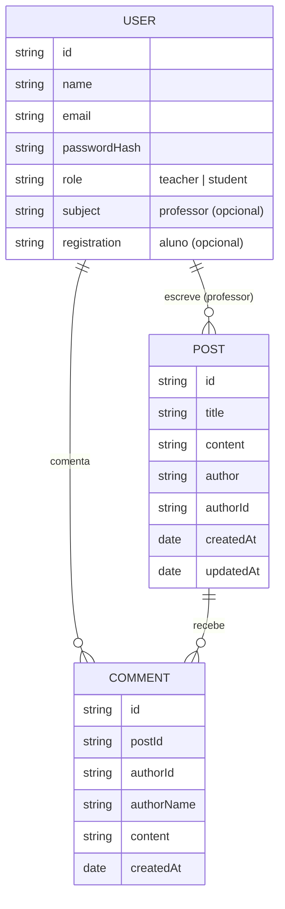

# Documentação do Projeto — Blog Escolar Mobile

**Tech Challenge · Fase 4 · FIAP Pós Tech**

Este documento descreve a arquitetura do sistema, o uso da aplicação e o relato das experiências e desafios enfrentados durante o desenvolvimento.

---

## 1. Contexto e objetivo

Depois das fases anteriores (back-end em Node.js e front-end web em React), o objetivo desta fase foi criar a interface **mobile** da plataforma de blogging da escola com **React Native**. A interface precisa ser acessível e fácil de usar e permitir que docentes e estudantes interajam com os endpoints REST de posts, professores, alunos e autenticação.

Resumo do que foi entregue:

- App React Native (Expo SDK 58 + TypeScript) com as 10 funcionalidades pedidas, incluindo os comentários opcionais.
- API REST em Node.js com todos os endpoints consumidos pelo app, autenticação JWT e controle de permissão por papel (professor × aluno).
- Testes automatizados da API e pipeline de CI no GitHub Actions.

---

## 2. Arquitetura do sistema

### 2.1 Visão geral

O sistema é dividido em dois projetos independentes no mesmo repositório:

| Projeto | Papel | Tecnologias |
|---------|-------|-------------|
| `mobile/` | Interface usada por professores, alunos e visitantes | React Native 0.88, Expo SDK 58, TypeScript, React Navigation 7, Context API |
| `backend/` | API REST que guarda e protege os dados | Node.js 22 (`http` + `crypto`), JWT, scrypt, persistência em JSON |

A comunicação é feita por HTTP/JSON. Depois do login, o app envia o token no header `Authorization: Bearer <token>`.

### 2.2 Aplicativo mobile

**Organização em camadas**

```
screens  →  hooks  →  services  →  api.ts (fetch)  →  API
   │                      ▲
   └──── AuthContext ─────┘
```

- **Screens (`src/screens`)**: cada tela monta a interface e trata as ações do usuário. As telas não chamam `fetch` diretamente.
- **Componentes (`src/components`)**: botões, campos de formulário, barra de busca, cards de post, linhas da tabela de pessoas, paginação e estados de carregamento, vazio e erro. Todos seguem os mesmos tokens de estilo.
- **Hooks (`src/hooks`)**:
  - `usePostsFeed`: listagem de posts com busca, "puxar para atualizar" e rolagem infinita.
  - `usePeoplePage`: listagem paginada (páginas numeradas) de professores e alunos.
  - `useDebounce`: espera o usuário parar de digitar antes de chamar a API.
- **Estado global (`src/contexts/AuthContext.tsx`)**: Context API com usuário logado, `isTeacher`/`isStudent`, `signIn`, `signOut` e restauração da sessão.
- **Services (`src/services`)**: um serviço por recurso (`postService`, `peopleService`, `commentService`, `authService`). O `api.ts` centraliza URL base, token, timeout de 15 segundos e conversão de erros em `ApiError` com as mensagens por campo vindas da API.
- **Navegação (`src/navigation`)**: stack principal com abas inferiores. Telas protegidas são registradas condicionalmente.
- **Tema (`src/theme`)**: paleta (roxo/índigo como cor principal, âmbar como destaque e verde-azulado para alunos), espaçamentos, raios, tipografia e sombras.

**Telas**

| Tela | Acesso | Função |
|------|--------|--------|
| Posts (Home) | todos | Lista com título, autor, data, resumo e nº de comentários; busca por palavra-chave |
| Leitura do post | todos | Conteúdo completo, comentários, envio e exclusão de comentários |
| Login (modal) | visitante | E-mail e senha, com atalhos para as contas de demonstração |
| Novo post / Editar post | professor | Formulário com título, autor e conteúdo, com validação |
| Admin | professor | Todas as postagens com Editar e Excluir |
| Professores / Alunos | professor | Listagem paginada com busca, Editar e Excluir |
| Novo/Editar professor e aluno | professor | Nome, e-mail, senha e disciplina (professor) ou matrícula (aluno) |
| Perfil | todos | Dados do usuário, permissões, logout e URL da API em uso |

**Autorização no app**

O `AppNavigator` só registra as telas de criação, edição e administração quando `isTeacher` é verdadeiro. Assim, alunos e visitantes não veem os botões e não conseguem navegar até essas telas. Quando o usuário faz login ou logout, a navegação se reorganiza sozinha (o modal de login fecha e as abas aparecem ou somem).

**Sessão**

- O token e os dados do usuário são salvos com `expo-secure-store` (Keychain no iOS, Keystore no Android). No Expo Web, que não tem SecureStore, é usado o `localStorage`.
- Ao abrir o app, a sessão salva é validada com `GET /auth/me`. Se o token expirou, o app volta para o modo visitante. Sem internet, a sessão salva é mantida.
- Qualquer resposta `401` com token salvo dispara o logout automático.

### 2.3 API

**Estrutura**

| Pasta/arquivo | Responsabilidade |
|---------------|------------------|
| `server.js` | Sobe o servidor e mostra os IPs da rede local para configurar o celular |
| `app.js` | CORS, leitura do corpo JSON (limite de 1 MB), execução das rotas e padronização de erros |
| `router.js` | Roteador com parâmetros (`/posts/:id`) e cadeia de middlewares |
| `routes.js` | Mapa de todas as rotas e suas permissões |
| `middlewares/auth.js` | `authenticate` (valida o JWT) e `requireRole('teacher')` |
| `controllers/` | Regras de autenticação, posts, pessoas (professores e alunos) e comentários |
| `db/` | Banco em arquivo JSON com escrita atômica e dados de exemplo |
| `utils/` | JWT (HS256), hash de senha (scrypt), validação e paginação |

**Segurança**

- Senhas nunca são salvas em texto puro: `scrypt` com salt aleatório e comparação em tempo constante.
- Tokens JWT assinados com HS256 e validade de 8 horas (configurável).
- O hash da senha nunca sai na resposta da API.
- Permissões validadas no servidor, independentemente do app: `401` sem login, `403` sem permissão.
- Regras de negócio: e-mail único (`409`), professor não pode excluir a si mesmo, aluno só exclui o próprio comentário.

**Por que sem dependências?** A API roda com `npm start` logo após clonar o repositório, sem instalação e sem banco externo, o que facilita a avaliação e a demonstração. A estrutura em controllers/middlewares/rotas é a mesma de um projeto Express, então a migração para Express + MongoDB/PostgreSQL é direta.

### 2.4 Modelo de dados



Professores e alunos ficam na mesma coleção `users`, diferenciados por `role`. Por isso o login é único, e as rotas `/teachers` e `/students` filtram pelo papel.

### 2.5 Principais decisões técnicas

| Decisão | Motivo |
|---------|--------|
| Expo (managed) em vez de React Native CLI | Roda no celular pelo Expo Go sem Android Studio/Xcode e funciona também no navegador para a demonstração |
| TypeScript | Tipos para as respostas da API e para os parâmetros de navegação, o que evita erros de rota e de campos |
| Context API em vez de Redux | O estado global se resume à sessão. Context é suficiente e evita boilerplate |
| Rotas condicionais | Padrão recomendado pelo React Navigation para autenticação: telas sem permissão nem existem na navegação |
| Componentes genéricos para professores e alunos | Os requisitos 5 a 8 têm a mesma estrutura. Uma configuração por tipo (`peopleConfig.ts`) evita duplicar telas |
| Rolagem infinita nos posts e páginas numeradas nas pessoas | Leitura de posts é contínua. A gestão de cadastros pedia "listagem paginada" explícita |
| Busca com debounce + descarte de respostas antigas | Evita chamar a API a cada tecla e impede que uma resposta atrasada sobrescreva uma busca mais nova |

---

## 3. Uso da aplicação

### 3.1 Como executar

1. **API**: `cd backend && npm start` (porta 3000; o terminal mostra o IP da rede).
2. **App**: `cd mobile && npm install && npx expo install --fix && npm start`.
3. Leia o QR Code com o Expo Go (celular na mesma rede Wi-Fi) ou pressione `a` (Android), `i` (iOS) ou `w` (navegador).

Contas de demonstração (senha `123456`): `professor@escola.com` e `aluno@escola.com`.

### 3.2 Jornada do visitante

1. Abre o app e vê a lista de posts.
2. Digita uma palavra na busca (por exemplo, "cerrado") e a lista é filtrada.
3. Abre um post e lê o conteúdo e os comentários.
4. Para comentar, toca em **Entrar para comentar**.

### 3.3 Jornada do aluno

1. Faz login. O app mostra "Olá, <nome>!" e as abas **Posts** e **Perfil**.
2. Lê os posts, comenta e pode excluir os próprios comentários.
3. Não vê botões de criação/edição nem as abas administrativas.

### 3.4 Jornada do professor

1. Faz login. Aparecem as abas **Admin**, **Professores** e **Alunos** e o botão **Novo** na Home.
2. **Criar post**: Novo → preenche título, autor (já vem com o nome do professor) e conteúdo → **Publicar post**. O app abre o post criado.
3. **Editar post**: na leitura, **Editar este post** (ou pela aba Admin) → formulário preenchido → **Salvar alterações**.
4. **Administrar**: aba **Admin** → lista de todas as postagens com **Editar** e **Excluir** (com confirmação).
5. **Professores/Alunos**: listagem paginada (5 por página) com busca. **Novo professor/aluno** para cadastrar, **Editar** para alterar (senha em branco mantém a atual) e **Excluir** para remover.
6. **Perfil**: dados da conta e **Sair da conta**.

---

## 4. Relato de experiências e desafios

### 4.1 Conectar o celular à API local

O primeiro obstáculo foi o clássico "funciona no computador, mas não no celular". Dentro do celular, `localhost` aponta para o próprio aparelho, e no emulador Android aponta para o emulador.

**Solução:** o app descobre o IP do computador a partir do endereço do servidor do Expo (`Constants.expoConfig.hostUri`), que é a mesma máquina da API. No emulador Android, `localhost` vira `10.0.2.2`. A variável `EXPO_PUBLIC_API_URL` continua disponível para casos especiais (túnel, API em outro servidor), e a API mostra o IP da rede ao iniciar. Quando a conexão falha, a mensagem de erro informa a URL que o app tentou usar.

### 4.2 Proteger as rotas no mobile

No web, rotas protegidas costumam ser feitas com redirecionamento. No React Navigation, a recomendação é **não registrar** as telas sem permissão. Tivemos que pensar a navegação a partir do estado de autenticação: o modal de login existe só para visitantes e as telas de escrita existem só para professores. Ao logar, o modal fecha sozinho, porque a tela deixa de existir.

Como o app pode ser contornado, a API valida token e papel em todas as rotas de escrita.

### 4.3 Sessão segura e persistente

Guardar o token em armazenamento comum não é o ideal no mobile. Usamos o `expo-secure-store`, que não existe no navegador. Criamos então uma pequena camada (`services/storage.ts`) que escolhe o armazenamento conforme a plataforma.

Também foi preciso decidir o que fazer com um token expirado ao reabrir o app. A sessão agora é validada com `/auth/me`, e qualquer `401` leva o usuário de volta ao modo visitante, sem travar a tela.

### 4.4 Busca sem "piscar" resultados errados

Com a busca chamando a API a cada letra, uma resposta lenta de "ce" podia chegar depois da resposta de "cerrado" e mostrar o resultado errado. Resolvemos com `useDebounce` (400 ms) e um identificador de requisição: respostas de buscas antigas são descartadas.

### 4.5 Reaproveitar as páginas de professores e alunos

O requisito 8 pede para replicar as páginas de professores para alunos. Em vez de copiar seis telas, criamos componentes genéricos (`PeopleListScreen` e `PersonFormScreen`) e uma configuração por tipo (`peopleConfig.ts`) com textos e campo extra (disciplina ou matrícula). As telas exportadas para a navegação são apenas "invólucros" com o tipo definido. Isso reduziu o código e garantiu comportamento idêntico nos dois casos.

### 4.6 Paginação e casos de borda

Para os cadastros, usamos páginas numeradas, como pedido. Um caso de borda apareceu: ao excluir o único item da última página, a tela ficava vazia. O hook `usePeoplePage` agora detecta isso e carrega a nova última página. Nos posts, a rolagem infinita junta as páginas sem duplicar itens.

### 4.7 Diferenças entre plataformas

O `Alert.alert` com botões, usado para confirmar exclusões, não funciona no React Native Web. Como usamos o navegador nas demonstrações, criamos `utils/dialogs.ts`, que usa diálogos nativos no Android/iOS e `window.confirm` no navegador.

### 4.8 Versões do ecossistema Expo

O Expo Go da loja só abre projetos da SDK mais recente, e cada SDK exige versões específicas das bibliotecas nativas. Aprendemos a usar `npx expo install` (em vez de `npm install`) para pacotes nativos e `npx expo install --fix` para alinhar tudo com a SDK. Documentamos isso no README para quem for rodar o projeto.

### 4.9 Aprendizados

- Pensar a navegação mobile a partir do estado (logado, papel) em vez de páginas e URLs.
- Separar UI, lógica de dados (hooks) e acesso à API (services) deixa as telas pequenas e fáceis de manter.
- Validar dos dois lados: no app para dar feedback rápido e na API para garantir a segurança.
- Tratar estados de carregamento, vazio e erro faz grande diferença na experiência de uso.

---

## 5. Melhorias futuras

- Banco de dados gerenciado (MongoDB ou PostgreSQL) e deploy da API em nuvem.
- Refresh token e expiração deslizante da sessão.
- Upload de imagens nos posts e avatar dos usuários.
- Notificações push para novos posts (Expo Notifications).
- Testes de componentes com Jest + React Native Testing Library.
- Modo escuro, a partir dos tokens de tema já existentes.
- Publicação nas lojas com EAS Build.
